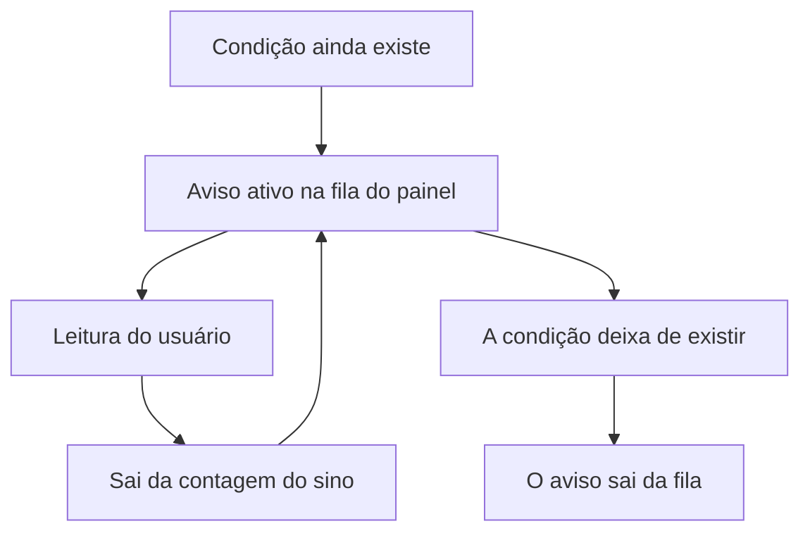
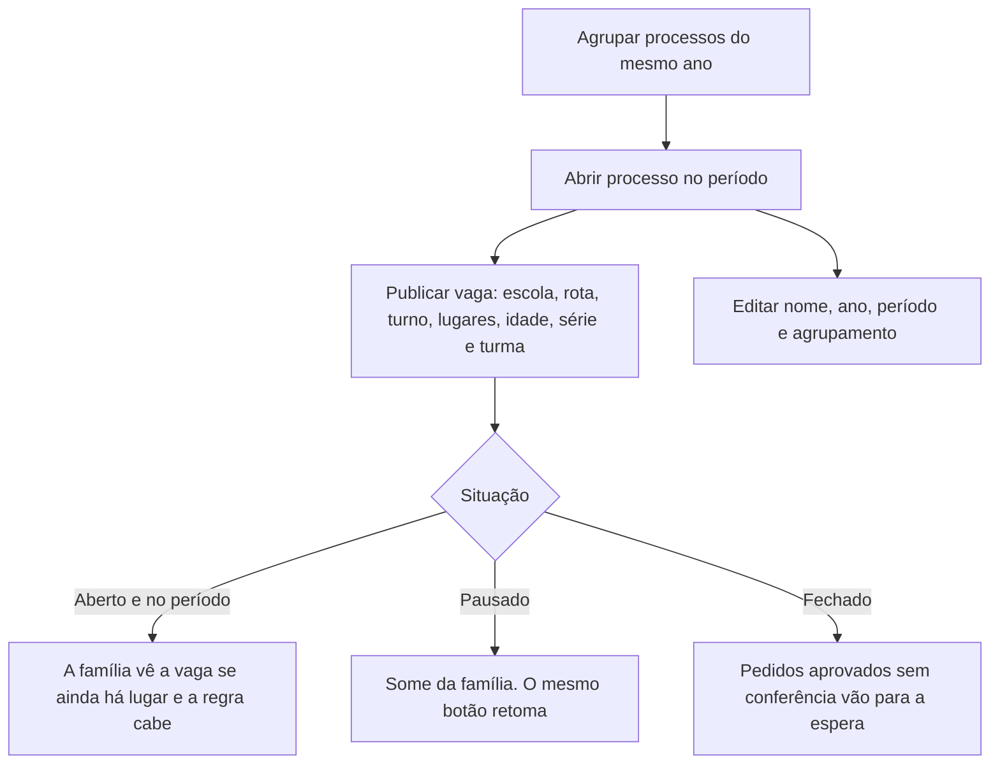
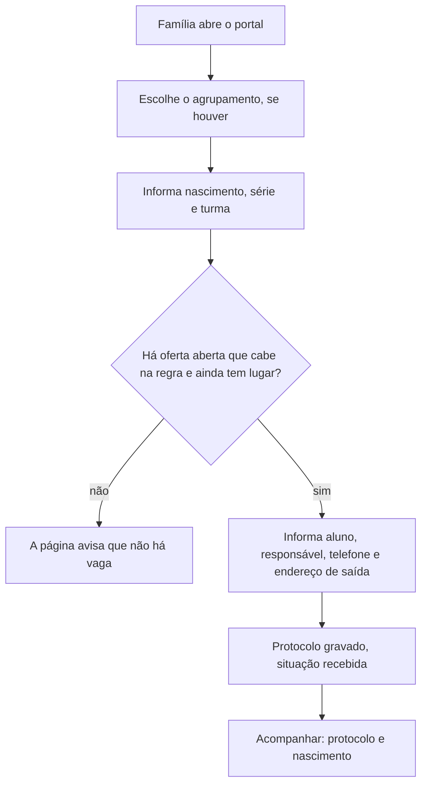
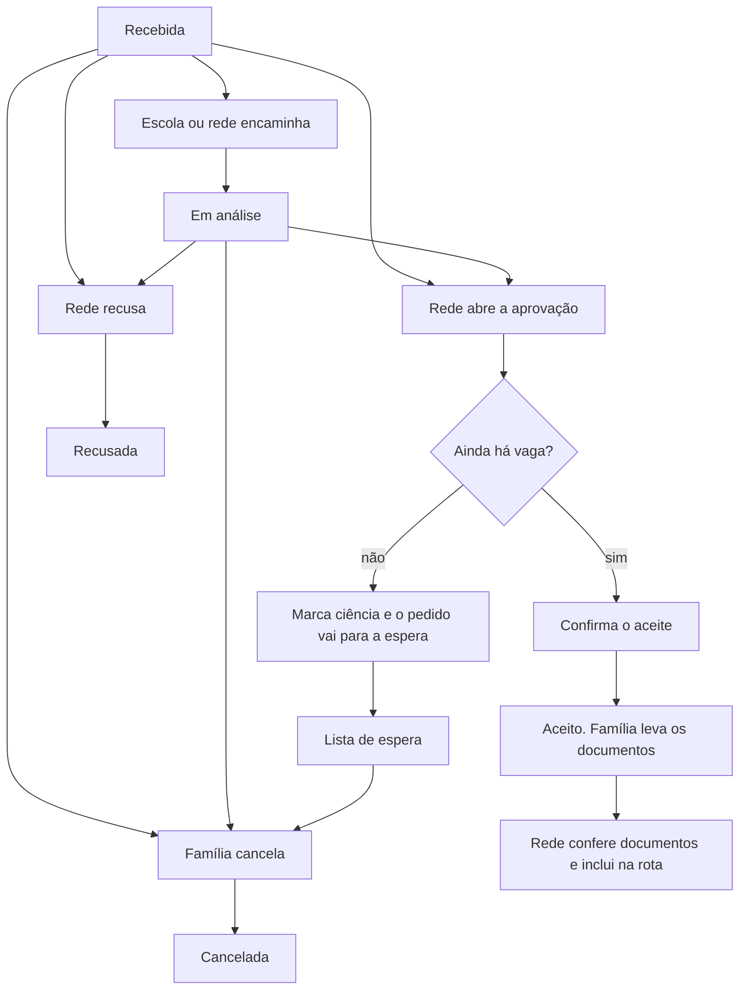
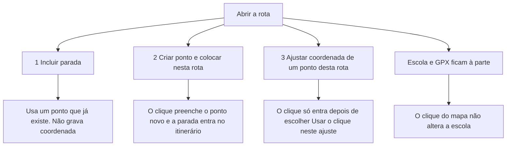
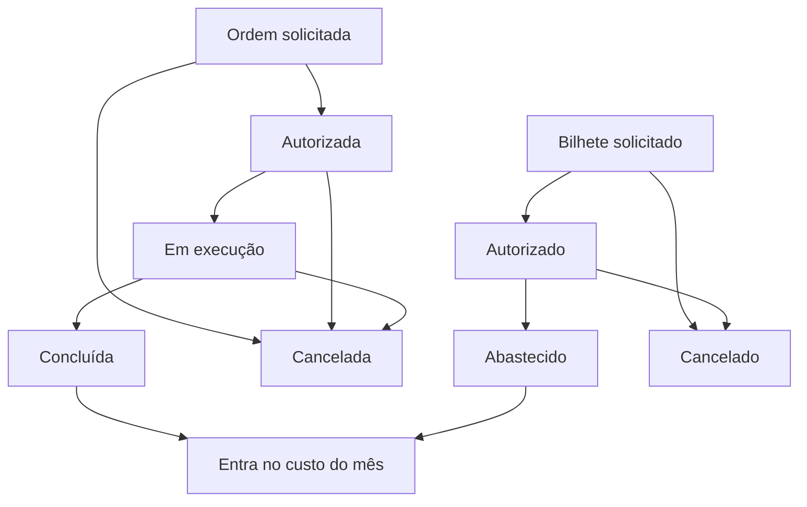

# Fluxos

A família não entra no menu do i-Educar. O institucional prepara a rede, abre o processo e publica a vaga. A escola encaminha o pedido da própria escola. A rede aceita ou recusa. O dia da rota, a frota e a conta ficam nas telas da equipe.

## Módulos

A barra lateral em `/transporte-escolar` agrupa as telas por função. O nome fica sempre visível.

| Módulo | O que a equipe faz |
| --- | --- |
| Início | Painel do dia e notificações internas |
| Cadastros | Empresas, veículos, motoristas, monitores, pontos, rotas e normas |
| Atendimento | Cópia do ano, pedidos da família e alunos transportados |
| Operação | Viagens, pacote offline, aviso à família e modelos de aviso |
| Frota | Conformidade, ordens de serviço, bilhetes, estoque e gastos |
| Contas | SETE, relatórios e auditoria |

O painel mostra indicadores em coluna, o mapa das rotas e a fila de atenção. Ida e volta com os mesmos pontos viram um traçado. O clique na rota mostra tempo, distância, alunos, veículos e motoristas. Relatórios e o painel do conselho são a mesma tela: quem tem o processo 880151 ou o 880152 abre os mesmos indicadores, no recorte do próprio perfil.

A cor do informe segue o tipo: azul para pedido da família, âmbar para prazo de CNH ou documento, vermelho para lotação acima dos lugares e verde para ordem ou bilhete ainda aberto.

## Processo de vagas

O institucional agrupa os processos que a família vê juntos, abre cada processo no ano letivo e publica a vaga com escola, rota, turno, quantidade, idade em 31 de março, série e turma. Série ou turma em branco significa qualquer uma. A tabela de processos e a de vagas publicadas mostram o total, as ocupadas, as disponíveis e a lista de espera quando houver. O processo pausado sai da página da família. O mesmo botão retoma. Fechar a vaga publicada encerra a oferta: os pedidos aprovados que ainda não foram conferidos vão para a lista de espera; quem já está na rota permanece. A vaga fechada volta com Retomar. Não há exclusão de processo nem de vaga. Se já existe pedido, o ano do processo e a escola, a rota e o turno da vaga permanecem. Se já existe pedido aceito, idade, série e turma também permanecem. As vagas não ficam abaixo dos pedidos que ainda ocupam lugar.

Pedido recebido, em análise, aceito ou com documentação conferida ocupa a vaga. Aluno já colocado na rota também ocupa a vaga daquela rota no processo, mesmo sem matrícula ativa no ano. Lista de espera, recusa e cancelamento devolvem o lugar. O grupo também pode ser pausado ou bloqueado: se o processo está num grupo, os dois precisam estar abertos e no período.

## Pedido da família

O endereço é `/transporte-escolar/familia`. O protocolo sai no formato `TE-ano-sequência-dígito`. A consulta pede o protocolo e a data de nascimento. Data errada e protocolo inexistente devolvem a mesma frase. A prefeitura não pede senha nem dados do aluno por rede social.

## Análise do pedido

Em `/transporte-escolar/solicitacoes`, cada linha tem Ver protocolo. A ficha mostra aluno, nascimento, responsável, telefone, endereço, escola, turno, processo, rota, série e turma antes de aceitar ou recusar. A observação da decisão aparece para a família na página Acompanhar.

Depois do endereço, a ficha calcula a distância até os pontos com coordenada. O mapa detalhado abre em outra aba. A consulta ao mapa usa só o texto do endereço. Nome, telefone e nascimento ficam no i-Educar.

Antes de gravar o aceite, a tela informa se a rota ainda tem vaga ou está lotada. Lotada, o pedido só segue depois da ciência e entra na lista de espera. Com vaga, a confirmação aceita o pedido. Pedido já decidido não volta. Aceitar não cria pessoa nem matrícula e ainda não coloca o aluno na rota.

Na conferência, o turno é o da rota escolhida. A matrícula pode ficar em branco: ela é feita no i-Educar. Sem matrícula ativa, o aluno entra na rota e o aviso permanece em Alunos na rota. Turno da turma diferente do da rota também permanece como aviso e não impede a inclusão. O processo pode listar os documentos obrigatórios; sem essa lista, a conferência pede só a confirmação. O histórico do protocolo fica no fim da ficha.

## Pedido aceito

A família vê documentos, horário, endereço e mapa só depois do aceite, e só com o que o institucional gravou em Pedidos da família. O mapa exige latitude e longitude válidas.

## Rota

Em `/transporte-escolar/rotas/{id}` há três ações diferentes. O clique no mapa preenche só o formulário que estiver escutando.

Coordenada fora do território brasileiro não entra no mapa. A escola com latitude ou longitude inválida fica fora do enquadramento até ser corrigida. Retirar uma parada refaz a ordem das demais. Ao alocar um veículo com menos lugares do que os alunos da rota, a tela informa quantas viagens são necessárias, o horário de cada uma e o mesmo percurso repetido. A inclusão manual de aluno continua exigindo matrícula já existente no i-Educar e não entra em rota com lista de espera de processo aberto.

## Cobertura no mapa da rota

O mapa mostra os pontos da rota, o raio de cada um, um raio de 500 m em volta da escola e a concentração das residências. Nome, endereço e data de nascimento não aparecem. A faixa de idade e a mancha de residências só entram com pelo menos três registros. Em cada ponto a equipe vê a quantidade de alunos, de embarques e de desembarques.

## Ordem de serviço e bilhete

O pedido nasce em Ordens ou em Bilhetes, com protocolo. A impressão é sempre duas vias na mesma folha: via 1, arquivo, em cima; via 2, canhoto, embaixo; linha tracejada com tesoura no meio. Cabeçalho e rodapé são curtos e trazem o município, o título, o protocolo e a via.

Ordem que não está concluída e bilhete que não está abastecido não entram no custo. O PDF não substitui nota fiscal nem o extrato da conta do PNATE.

## Gastos do mês

A tela `/transporte-escolar/gastos` abre pelo mês. Os totais separam PNATE, recurso próprio e outras fontes. A composição soma o bilhete abastecido, a ordem concluída, o gasto do art. 13, o contrato medido pelas viagens e o salário rateado em recurso próprio. Combustível e serviço não se lançam nesta tela: nascem em Bilhetes e Ordens. Aqui entram o gasto do art. 13, o contrato, o plano preventivo, a parcela informada e as regras da cerca, do transporte aquaviário e do rateio.

## Frequência da viagem

A tela Frequência lista cada viagem do mês e emite o PDF da chamada. Presente só aparece quando houve embarque. Sem marcação, a linha é falta. No mês, o aluno é frequente se embarcou ao menos uma vez na rota; se todas as viagens ficaram sem marcação, a situação é não frequente. O perfil da escola vê apenas as rotas das escolas que ele acessa. O institucional vê a rede.

## Chamada pelo aplicativo

O aplicativo ainda não existe. A API que ele vai usar já recebe a marcação na hora e a fila gravada no aparelho quando a rede volta. O dispositivo se identifica pelo token, no cabeçalho `Authorization: Bearer` ou `X-Transporte-Token`, e precisa estar ligado a um motorista ou a um monitor.

- `GET /transporte-escolar/api/chamada?data=AAAA-MM-DD` devolve as viagens daquele dia, com aluno, cartão, QR e a marca atual.
- `POST /transporte-escolar/api/chamada` recebe `eventos`. Cada evento traz `uuid`, `viagem_id`, `tipo` (`embarque`, `falta` ou `desembarque`), `origem` (`motorista`, `monitor` ou `rfid`) e `aluno_id` ou `cartao`.
- O mesmo `uuid` enviado de novo não grava outra presença. A falta apaga o embarque. O embarque é a presença.

## O que estes fluxos ainda não fazem

- Aceitar o pedido não coloca o aluno na rota. A inclusão é a conferência da documentação.
- Não há limite de um pedido por aluno.
- A lista de espera não tem peso nem prioridade. Ela guarda o pedido analisado quando a rota está lotada ou quando a vaga publicada é fechada.
- Não há envio de SMS nem notificação de celular.
- O módulo não envia a prestação ao SiGPC e não gera folha de pagamento.
