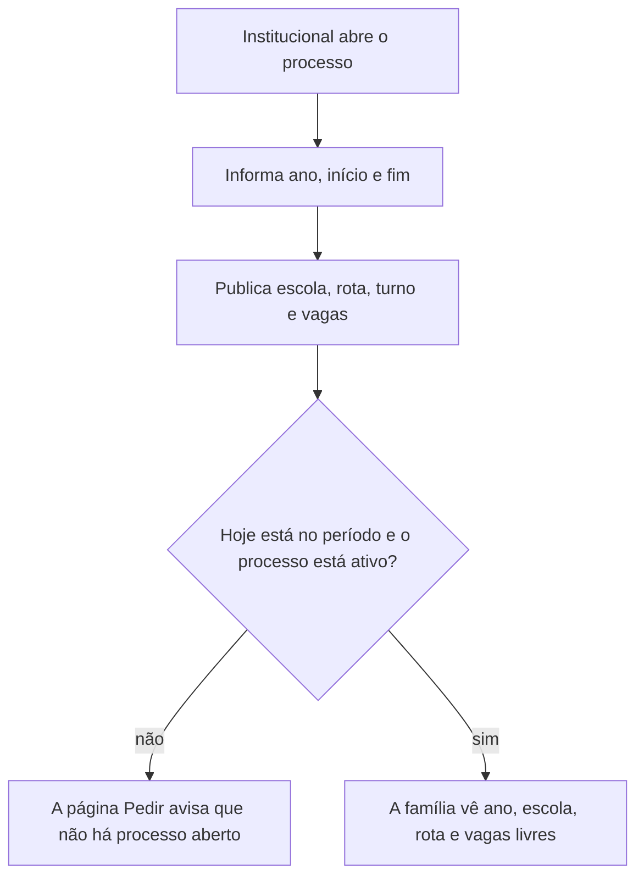
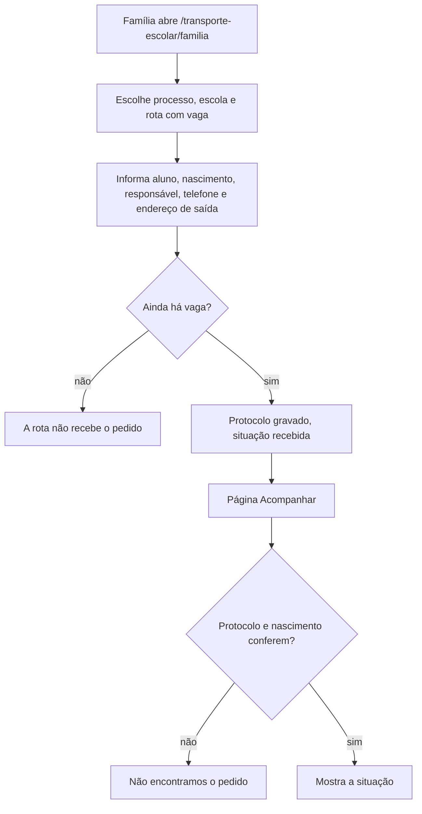
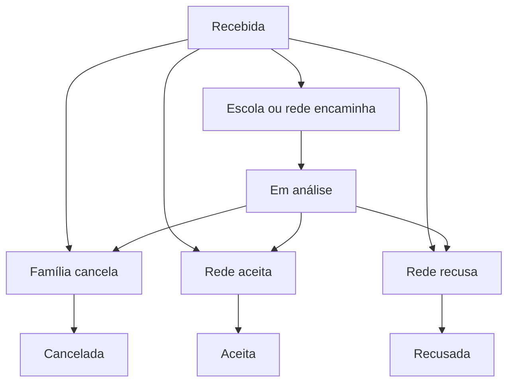
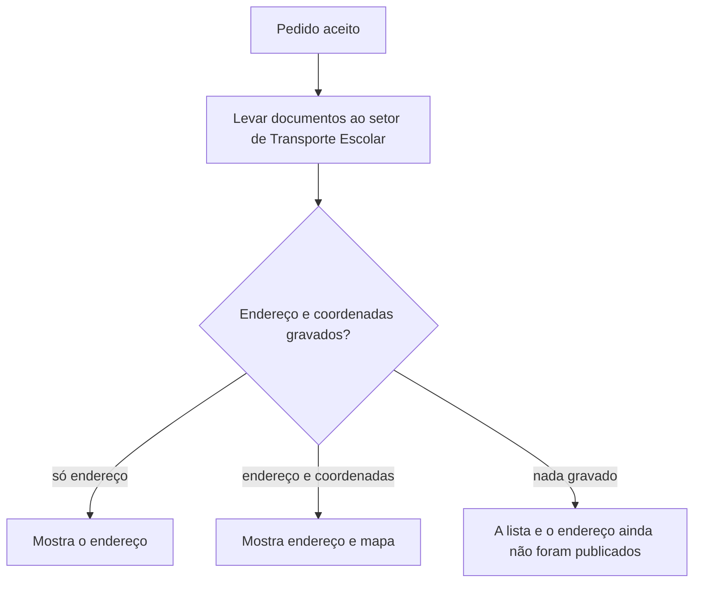

# Fluxos

A família não entra no menu do i-Educar. O institucional abre o processo de vagas. A escola encaminha. A rede aceita ou recusa.

## Processo de vagas

O processo vale para um ano letivo e um período, no mesmo espírito da pré-matrícula. Fora do período, ou sem vaga publicada, a família não envia pedido.

## Pedido da família

O protocolo sai no formato `TE-ano-sequência-dígito`. A consulta pede o protocolo e a data de nascimento. Data errada e protocolo inexistente devolvem a mesma frase.

Pedido recebido, em análise ou aceito ocupa a vaga. Recusado ou cancelado devolve o lugar.

## Análise

A escola só vê o pedido da própria escola e só encaminha. Aceitar ou recusar é da rede. Pedido já decidido não volta.

## Pedido aceito

A família vê documentos, horário, endereço e mapa só depois do aceite. O mapa depende de latitude e longitude gravadas pelo institucional. A prefeitura não pede senha nem dados por rede social. O andamento fica na página Acompanhar.

